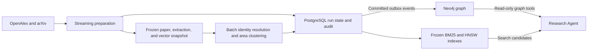

# Research KG Builder

KG Builder turns scientific papers into a versioned knowledge graph. It preserves the path from a retrieved method, benchmark, research problem, or contribution back to the paper and abstract that supplied the evidence. The graph supports a separate [Research Agent](https://github.com/cao8011158/research-agent) that uses a locally hosted LLM to discover candidates and follow those paths.

## Architecture



- **PostgreSQL** stores normalized papers and source versions, task leases, review decisions, embeddings, graph state, and the publication outbox. It is the authoritative build and recovery state.
- **Neo4j Community Edition** serves the graph. It stores version and evidence paths, entity assignments, and research-area memberships under a graph namespace.
- **BM25 and HNSW** find lexical and semantic candidates. The agent uses their node IDs and graph namespace to retrieve source evidence from Neo4j. The agent harness and local model serving live in the separate Research Agent repository.

The current implementation combines streaming preparation, a snapshot-based batch build, incremental graph publication, and replayable update batches.

## Corpus and source selection

The project studies long-term agent memory, context management and compression, and procedural skill acquisition, reuse, and improvement. The inclusion window starts on **2025-01-01** and uses the first public release where the evidence supports that date. The full build used a collection window ending on **2026-11-02**. A paper needs a substantive connection to at least one topic. See the [research scope](docs/CURRENT_RESEARCH_SCOPE.md) and [full collection plan](config/full_preparation_plan.json).

| Source | Search and pagination | Captured evidence |
| --- | --- | --- |
| OpenAlex | Title-and-abstract search with cursor pagination across date windows | Work ID, title, publication date and year, authors, DOI and other IDs when available, source URL, and an abstract reconstructed from the inverted index |
| arXiv | Title and abstract terms, a submission date filter, and paginated Atom results | arXiv ID, title, authors, publication and update dates, version label when supplied, optional DOI, source URL, and the abstract from the Atom summary |

Discovery queries combine LLM and agent terms with terms for the three research topics. Search results enter a candidate pool. Jev uses the title and abstract to decide whether a paper meets scope, with uncertainty retained in the review record. Approved extraction tasks use the pinned abstract as source text. The full build collected **11,339 source hits** and produced **8,270 canonical candidate papers**. Scope review admitted **3,163 papers**. After extraction and item review, **3,162** had usable items and entered the frozen graph input.

### Paper identity and versioning

Strong source identifiers, including normalized DOI and arXiv identifiers, let records from different providers point to one logical paper. Source records retain the original provider payload and version provenance. Conflicting strong identifiers are isolated for inspection. Titles and abstracts support scope review, while identity resolution uses the recorded identifiers and aliases.

A `Paper` can have multiple `PaperVersion` records. A provider-confirmed version carries a `vN` label. An unverified metadata snapshot retains its own identity and a null version label. Extraction and graph publication use the exact version and source URL recorded with the accepted text. A newer source version can therefore coexist with the version used to build a published graph.

## Streaming preparation

Preparation consumes a finite collection plan through paginated API requests. Collection, scope review, extraction, and item review can overlap. As soon as a paper passes scope review and has eligible source text, an extraction worker can claim it while collection and screening continue for other papers.

1. **Collect and normalize.** Persist source pages and checkpoints, deduplicate papers, and retain uncertain identifiers or missing source text for inspection.
2. **Screen for scope.** Store the decision and evidence. Only eligible papers enter extraction.
3. **Extract.** An external worker claims a leased task and submits a structured draft pinned to its paper, version, and input. The full run used external workers for extraction and repair. The optional API extractor follows the same validation boundary.
4. **Review items independently.** Jev checks each item against its source text. Approval requires the `supported` choice and `P(supported) >= 0.70`. Completeness is recorded separately. One repair is available for a failed item. A second failed review drops that item from downstream processing and retains its audit record.
5. **Freeze approved data.** A paper with at least one approved item can enter the snapshot after its review tasks finish. Export waits for sealed collection and terminal preparation state.

Tasks carry a lease and input fingerprint. Submissions are validated against both. Repair tasks target the failed keys and preserve approved payloads. Bounded workers and request batches allow stages to advance independently. PostgreSQL retains progress so a restarted process can resume the same run.

See [PostgreSQL preparation](docs/POSTGRES_PREPARATION.md), the [streaming workflow](docs/STREAMING_WORKFLOW.md), and the [current Jev decision contract](docs/JEV_CONTEXT_CONTRACT.md).

### Extraction schema

The v0.3 retrieval schema has four arrays. A research problem describes a question or obstacle. A method describes an approach and its role in the paper. A benchmark records the evaluation resource, its role, and any known version or subset. A contribution is an author-reported claim tied to a paper version.

The following illustrative draft uses invented content and identifiers. Each item has a stable key, and the record carries its exact source version and URL.

```json
{
  "schema_version": "research-kg-extraction/0.3-retrieval",
  "paper_id": "paper:example",
  "version_id": "paper:example@v1",
  "paper_version": {"version_label": "v1", "source_url": "https://example.org/papers/memory-v1"},
  "extractor_type": "assistant_manual",
  "extractor_version": "example-v1",
  "source_scope": "abstract_only",
  "status": "draft_requires_review",
  "research_problems": [
    {"key": "problem:recall", "name": "Long-term recall", "description": "Agents lose access to earlier decisions."}
  ],
  "methods": [
    {"key": "method:retrieval", "name": "Selective retrieval", "description": "Retrieve relevant decisions from memory.", "role": "proposed"}
  ],
  "benchmarks": [
    {"key": "benchmark:recall", "name": "Recall Tasks", "description": "Tasks that require recalling earlier decisions.", "roles": ["used"], "version_or_subset": null}
  ],
  "contributions": [
    {"key": "paper:example@v1#c1", "description": "The authors propose a selective retrieval mechanism."}
  ]
}
```

An array can be empty when the abstract supplies no supported item of that kind. The [extraction contract](docs/RETRIEVAL_EXTRACTION_V0_3.md) defines field requirements and allowed roles. The final snapshot stores approved payloads and separate review metadata.

## Batch graph construction

The immutable preparation snapshot contains approved paper metadata, pinned source text, reviewed extractions, item review provenance, and vectors. Its digest binds the graph job to one input. The full graph used **Voyage `voyage-4-large`, 1,024 dimensions** for approved item texts. Embedding provider, model, and dimensions must be compatible with the snapshot. Document and query encoding use separate roles. See [embedding operations](docs/EMBEDDINGS.md).

### Method and benchmark entity resolution

1. Build within-kind HNSW neighborhoods over the snapshot vectors and deduplicate the resulting candidate pairs. The full build used `k=20`.
2. Ask Jev whether each pair describes the same concrete object. The full build accepted `same` at `P(same) >= 0.60` and `different` at `P(different) >= 0.70`. Other outcomes remain pending.
3. Form provisional components from accepted `same` links. Under `whole-group-v1`, Jev receives the entire provisional component and reviews each member against its dominant identity.
4. Exclude a member from the component only when the answer is `not_belongs` and `P(not_belongs) > 0.70`. Unmatched and excluded mentions remain searchable through separate entities. Pending pairs and conflicting judgments remain in the audit.

Similarity proposes candidates. Pair and group decisions determine which mentions share an entity. For example, the published snapshot links the `LongMemEval-S` mentions from `arxiv:2604.12948` and `arxiv:2608.08055` to the same Benchmark node, `entity:ceb29cefabd43c433596b4f36ad16e56`. Both paper-specific mentions remain available for inspection.

### Research problem clustering

Each extracted problem remains a distinct `ResearchProblem`. The builder creates a similarity graph over all research problems in the snapshot and partitions it using Leiden CPM. The full build used a resolution of `0.05`. A naming worker reads the members of each multi-item cluster and supplies an area name and description. Jev reviews individual memberships against that theme. Singletons remain searchable on their own. A `MEMBER_OF` relationship expresses thematic membership, while `RESOLVES_TO` connects a source mention to its resolved entity. See the [domain graph policy](docs/GRAPH_POLICY_V1.md) and [external graph worker protocol](docs/EXTERNAL_GRAPH_WORKERS.md).

## Graph schema and provenance

| Node | Role and key properties |
| --- | --- |
| `Paper` | Logical paper identity and title |
| `PaperVersion` | Pinned source URL, version label, source text, and source fingerprint |
| `Source` | Provenance for a reviewed extraction, including paper and version IDs, snapshot hash, and review metadata |
| `SourceItem` | Paper-specific research problem, method, or benchmark mention with its name, description, roles, and version or subset where available |
| `Contribution` | Author-reported contribution and its original source payload |
| `ResearchProblem`, `Method`, `Benchmark` | Searchable entity with a name, description, and aliases where applicable |
| `ResearchArea` | Named theme with a description and links from its retained research problems |

```text
Paper -HAS_VERSION-> PaperVersion -HAS_SOURCE-> Source
Source -HAS_ITEM-> SourceItem -RESOLVES_TO-> ResearchProblem | Method | Benchmark
Source -HAS_ITEM-> Contribution
ResearchProblem -MEMBER_OF-> ResearchArea
```

A method and a benchmark reached through the same `Source` share a paper-level provenance path. A claim that the paper evaluated a particular method on that benchmark requires supporting text. Contributions record what the authors report. The graph schema preserves the evidence needed to separate these interpretations.

### Read-only example

This query follows the Zep paper in the published graph. Set `$graph_namespace` to the Neo4j namespace from the release manifest and `$paper_id` to `arxiv:2501.13956`. The frozen release uses the version node `arxiv:2501.13956@unverified:63b0099734ed32ae1925` for this source. The graph preserves that marker when returning evidence.

```cypher
MATCH (p:KGNode:Paper {run_id: $graph_namespace, node_id: $paper_id})
      -[:HAS_VERSION]->(v:PaperVersion)-[:HAS_SOURCE]->(s:Source)
      -[:HAS_ITEM]->(item:SourceItem)
OPTIONAL MATCH (item)-[:RESOLVES_TO]->(entity:KGNode)
RETURN p.title AS paper, v.node_id AS version_id, v.source_url AS source_url,
       item.kind AS kind, item.name AS mention, item.description AS evidence,
       item.roles AS roles, entity.node_id AS entity_id
ORDER BY kind, mention, item.node_id
LIMIT 30
```

## Neo4j publication and recovery

PostgreSQL commits graph changes with durable outbox events. The publisher reads pending events in bounded batches and applies each event in a Neo4j transaction while the build advances. Neo4j identifies nodes by `(run_id, node_id)` and projection events by `(run_id, event_id)`. The event identity and payload hash allow a committed event to be replayed after a delivery or acknowledgement failure. Graph data and projection audit markers have separate counts.

Keep the immutable snapshot, the credential-free `graph-job.json` descriptor, and the PostgreSQL run state. To resume, use the same run ID, job directory, and input snapshot. Check completion, retrieval index status, and pending projection events before selecting a release. For backup and recovery procedures, see [PostgreSQL preparation](docs/POSTGRES_PREPARATION.md) and [graph operations](docs/POSTGRES_GRAPH.md).

### Update a published graph

An update takes a completed base graph, its exact snapshot, and an approved delta. Paper additions and replacements use canonical paper IDs. Removals require explicit paper IDs. The update prepares a new snapshot and publishes a new graph namespace.

- Method and benchmark resolution reuses compatible decisions for unchanged evidence. New and changed mentions search for candidates in their own type.
- Research problem clustering runs on the updated corpus. Unambiguous continuations can retain the logical entity or area ID. Splits and merges are recorded in the revision lineage.
- Rerunning the same batch resumes the same revision. `release.json` is written after completion, structural validation, outbox delivery, and a matching BM25 build. The previous graph remains available under its own namespace.

The manual publishing command accepts `--prepare-only` to write the merged snapshot without opening graph services. An external scheduler can invoke the same workflow through `scripts/scheduled_refresh.py`. Scheduled invocation requires explicit opt-in and an already approved batch. See [incremental publishing commands](docs/POSTGRES_GRAPH.md#incremental-graph-publishing).

## Retrieval and Research Agent integration

- **BM25** ranks title and abstract text, entity names and descriptions, contribution descriptions, and research-area summaries. It returns typed seeds with graph IDs and source provenance.
- **Persistent HNSW** retrieves semantically similar seeds using the compatible query-role vector. The frozen indexes are scoped by graph run and namespace, with snapshot and model identities checked where applicable.
- **Cypher** retrieves graph facts and provenance paths for the selected seeds. The Research Agent exposes read-only graph tools, including an official Neo4j MCP integration, so the locally hosted model can make bounded tool calls and cite the source it retrieves.

The [Colab restore guide](https://github.com/cao8011158/kg-builder/blob/c349254604ddd44ab70ce669b1dac4794e0f2c2f/docs/COLAB_KG_RUNTIME.md) describes the Drive-hosted query bundle with Neo4j graph data, BM25, and persistent HNSW. The [Research Agent runtime guide](https://github.com/cao8011158/research-agent/blob/7147211e282b4021152e806cdab3f5b126601a26/docs/COLAB_KG_AGENT.md) covers the local Strata model and the tool loop.

## Run the pipeline

Use Python 3.10 or later, a PostgreSQL service for build state, and a Neo4j service for graph publication. Set `KG_DATABASE_URL` for preparation and `KG_GRAPH_DATABASE_URL` for the graph when it uses a separate connection. Set `NEO4J_URI`, `NEO4J_USERNAME`, and `NEO4J_PASSWORD` for publication. `NEO4J_DATABASE` defaults to `neo4j`. The OpenAlex collector accepts `OPENALEX_API_KEY`. Jev and Voyage credentials come from `TYPESAFE_API_KEY` and `VOYAGE_API_KEY`. Keep credentials, raw snapshots, and private audit data outside Git.

```bash
python -m pip install -e '.[semantic,voyage,neo4j,bm25]'
```

**1. Prepare papers and export a frozen snapshot.** The full run uses the collection plan below. While the preparation process runs, external extraction workers use `claim` and `submit` in separate processes under the same run ID. After preparation reaches a terminal state, export the snapshot.

```bash
python scripts/prepare_full_pipeline.py --run-dir runs/prep --run-id prep-001 run \
  --plan config/full_preparation_plan.json

# In a separate shell, claim extraction work. Use --kind repair_extraction for repairs.
python scripts/prepare_full_pipeline.py --run-dir runs/prep --run-id prep-001 claim \
  --kind extract --worker extraction-1 --output runs/prep/claims.json
# Submit worker-produced results for the claimed tasks.
python scripts/prepare_full_pipeline.py --run-dir runs/prep --run-id prep-001 submit \
  --input runs/prep/results.json

# Export after preparation reaches a terminal state.
python scripts/prepare_full_pipeline.py --run-dir runs/prep --run-id prep-001 snapshot \
  --output runs/prep/prepared.json --embedding-provider voyage \
  --embedding-model voyage-4-large --embedding-dimension 1024
```

**2. Build, name, and validate the graph.** The default naming path uses external workers. Claim and submit their results using the same graph job directory, then rerun `run` to finish the job. Use the graph CLI's `status` subcommand to check progress.

```bash
python scripts/build_snapshot_graph.py --snapshot runs/prep/prepared.json \
  --job-dir runs/graph --run-id graph-001 --neo4j run

python scripts/build_snapshot_graph.py --snapshot runs/prep/prepared.json \
  --job-dir runs/graph claim --worker naming-1 --output runs/graph/name-tasks.json
python scripts/build_snapshot_graph.py --snapshot runs/prep/prepared.json \
  --job-dir runs/graph --neo4j submit --input runs/graph/names.json

# After all naming tasks have been submitted, rerun the build command and validate.
python scripts/validate_snapshot_graph.py --snapshot runs/prep/prepared.json \
  --job-dir runs/graph --output runs/graph-acceptance.json
```

**3. Build retrieval artifacts.** BM25 uses the completed PostgreSQL graph run. Persistent dense index builds and bundle exports are documented in the Colab restore guide.

```bash
python scripts/bm25_retrieval.py build --run-id graph-001 --index-dir runs/bm25
```

For a bounded development run, start with the [preparation CLI guide](docs/POSTGRES_PREPARATION.md#preparation-command-shape). Legacy SQLite collectors and importers are covered in [historical collector operations](docs/COLLECTOR_OPERATIONS.md).

## Full-build results and validation

| Measure | Recorded result |
| --- | ---: |
| Papers in the frozen graph | 3,162 |
| Approved extraction items | 18,355 |
| Resolved or separately materialized entities | 8,589 |
| Research areas | 72 |
| Neo4j graph nodes | 36,502 |
| Neo4j relationships | 38,125 |

- **Structural acceptance.** The full run checked source and version pins, item coverage, group and area membership, and agreement between PostgreSQL and the Neo4j projection. The completed outbox had zero pending deliveries. A restart recovered the completed state without new embedding or review requests.
- **Retrieval smoke test.** All 24 source self-retrieval cases returned their known source at rank one. This measures known-source lookup. Held-out entity resolution and retrieval quality require separate evidence.
- **Agent evaluation design.** Seven prompts cover open scientific comparisons, provenance checks, and absent or unsupported graph evidence. The rubric draws on the frozen graph and selected sections of original papers. It scores correctness, source support, and whether the answer distinguishes graph facts from inference. The source lookup scores and the agent evaluation address different questions.
- **Update verification.** The incremental path was tested with isolated PostgreSQL, synthetic revisions, and a simulated Neo4j publisher. Scheduled production refresh and live updates to the full graph remain unexercised.
